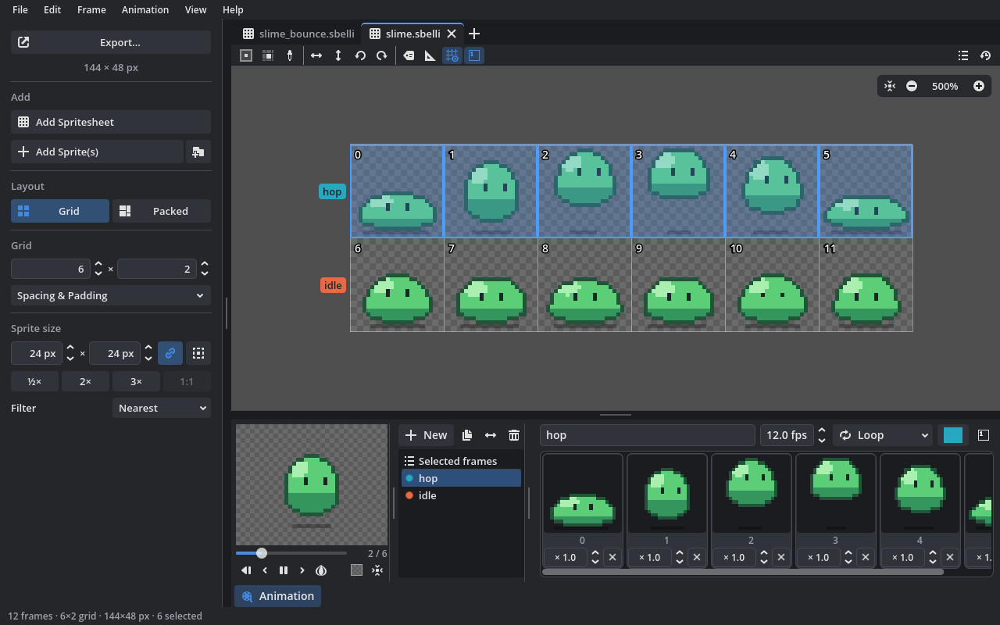
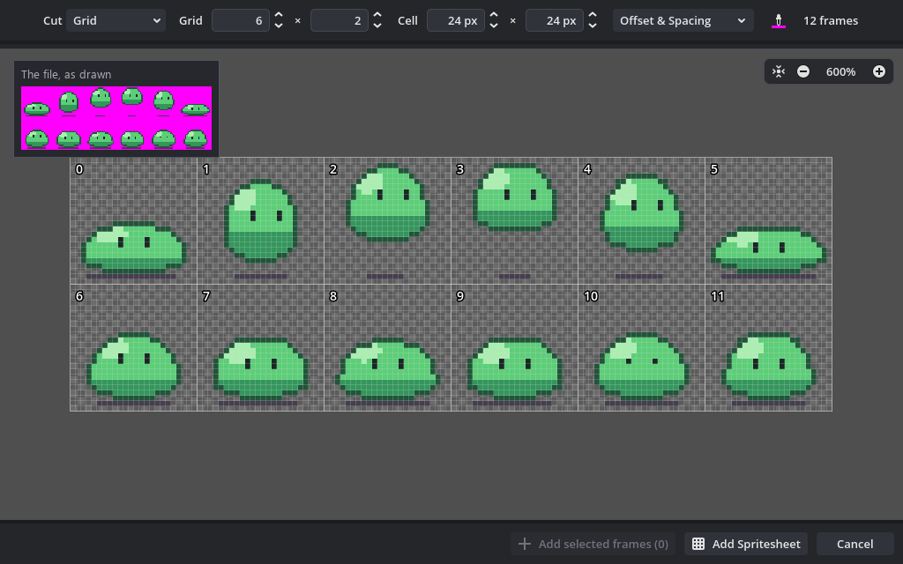
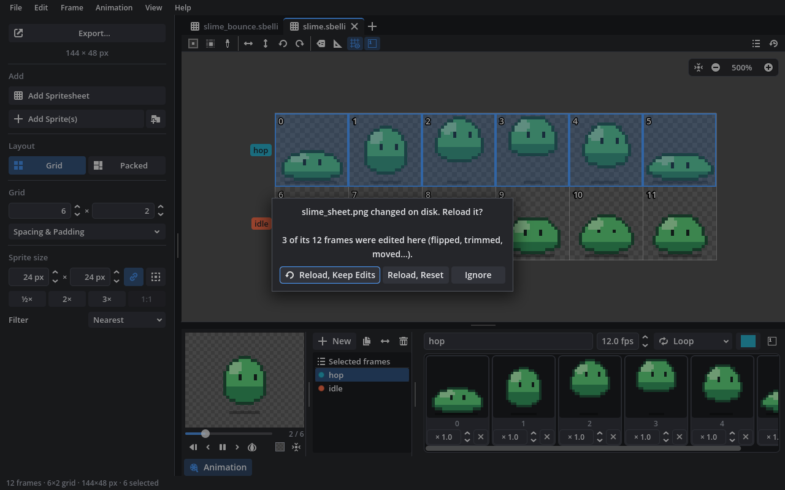
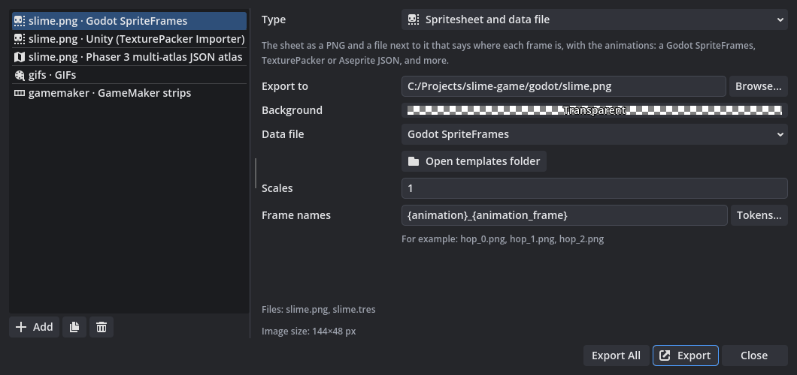
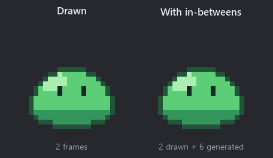
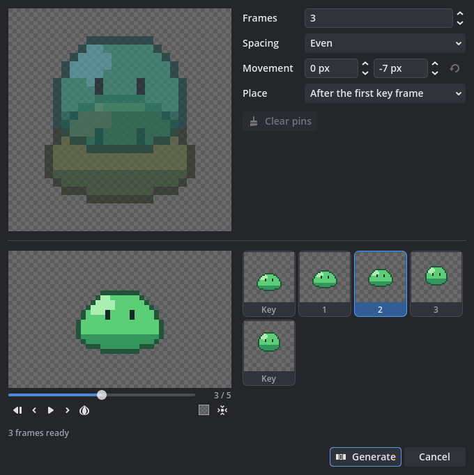

<p align="center"></p>

<h1 align="center">spritesheetbelli</h1>

<p align="center"><b>Your sprites, game-ready.</b><br>
Cut, pack, animate and export spritesheets for any engine.</p>

<p align="center">
  <a href="https://github.com/caleb-tognoli/spritesheetbelli/releases"><b>Download</b></a> ·
  <a href="docs/features.md">Features</a> ·
  <a href="docs/command-line.md">Command line</a> ·
  <a href="CONTRIBUTING.md">Contributing</a>
</p>

<p align="center">
  
  
  
</p>

<picture>
  <source media="(prefers-color-scheme: light)" srcset="docs/screenshot-light.png">
  
</picture>

spritesheetbelli sits between your drawing program and your game engine. Drop in loose
frames or a finished sheet, line them up, turn them into animations, and export exactly
what your engine expects. No copying numbers into import settings, no re-cutting a sheet
because one frame changed.

## Cut any sheet



Open a sheet and the grid is already worked out, from the file name (`hero_32x32.png`),
the gaps between sprites or the data file next to it. Solid backgrounds like magenta are
made transparent before cutting. Loose sprites are found by the space around them, and
atlases from TexturePacker, Aseprite, Phaser, libGDX or Spine unpack frame for frame,
tags included.

## Your art files stay in charge



Every frame remembers the file it came from. Save it again in Aseprite, Photoshop or
Krita and spritesheetbelli offers to reload it, keeping the flips, trims and moves you
made here. Link a folder and new frames show up on their own as you save them.

## Export for every engine



One project, every format you ship:

| Engine or tool | What you get |
| --- | --- |
| **Godot** | A `SpriteFrames` resource with every animation |
| **Unity** | A `.tpsheet` for the free TexturePacker Importer, with pivots |
| **Phaser 3** | A multi-atlas JSON |
| **GameMaker** | `walk_strip8.png` strips, one per animation |
| **libGDX / Spine** | An `.atlas` file |
| **Defold, Cocos2d-x, Sparrow / Starling** | A tile source, a `.plist`, an XML |
| **Web** | CSS or SCSS sprites, with `@2x` images |
| **Everything else** | TexturePacker / Aseprite JSON, or [a template of your own](docs/templates.md) |

Plus PNG, JPG and WebP sheets, every frame as its own file, packed atlases and animated
GIFs, at as many scales as you need. A project remembers its exports, so **Export Again**
writes them all at once, from the app or from your build script:

```sh
spritesheetbelli --headless -- --export hero.sbelli
```

## Draw the keys, get the rest

<p align="center"></p>

Pick two frames and spritesheetbelli fills in the ones between them, evenly or eased in
and out. Each part of the sprite turns around its joint, cloth and limbs bend, and no
new colours show up in your palette. Preview the result, nudge it with pins if a limb
goes the wrong way, and the new frames land in every animation that plays those keys.

<details>
<summary>The Generate In-Betweens window</summary>


</details>

## And the rest

- **Animations.** Turn a row into an animation in one keystroke, set how long each frame
  shows on a timeline, mirror `walk_right` into `walk_left`, and preview with onion skin.
- **Packed atlases.** Trimmed, rotated and tightly packed, with frames you can drag
  around and pin in place.
- **Pixel-perfect.** Resizing always starts from the originals, the zoom never blurs, and
  guides repeat in every cell so frames line up on one baseline.
- **Frame editing.** Flip, rotate, trim, outline, remove backgrounds, paste from other
  apps. All undoable.
- **Comfortable.** Projects in tabs, crash recovery, a command palette (Ctrl+Shift+P),
  pivots, light and dark themes, in English and Italian.

[See everything it does →](docs/features.md)

## Download

Grab the latest build for Windows, macOS, Linux or the web from
[Releases](https://github.com/caleb-tognoli/spritesheetbelli/releases).

- **Windows:** run `spritesheetbelli-…-windows-setup.exe` (no administrator rights
  needed), or use the `.zip` without installing. The builds aren't signed, so the first
  time Windows may say it protected your PC: click **More info**, then **Run anyway**.
- **macOS:** move the app to Applications. The app isn't notarized by Apple, so the
  first time macOS won't open it: click **Done**, open **System Settings > Privacy &
  Security**, and click **Open Anyway** next to spritesheetbelli. Or, in Terminal:
  `xattr -dr com.apple.quarantine /Applications/spritesheetbelli.app`.
- **Linux:** extract the archive and run `./install.sh`, which adds the launcher and the
  `spritesheetbelli` command (`./install.sh --uninstall` removes it).
- **Web:** runs in the browser; opening files uses the browser's file picker and saving
  downloads the result.

Installed, it opens `.sbelli` projects on double-click and shows up in "Open with" for
images and spritesheet data files.

## For developers

- [Command line](docs/command-line.md): pack, cut and export from build scripts.
- [Data file templates](docs/templates.md): add your own export formats.
- [Contributing](CONTRIBUTING.md): building from source, tests, translations and releases.

## License

[MIT](LICENSE)
